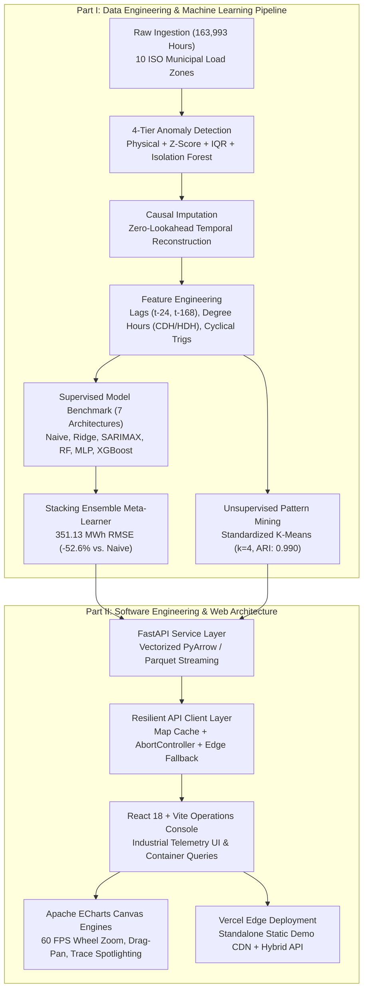

# GridPulse AI — Smart Grid Demand Forecasting & Telemetry Platform

[](https://www.python.org/)
[](https://fastapi.tiangolo.com/)
[](https://react.dev/)
[](https://vitejs.dev/)
[](https://echarts.apache.org/)
[](https://scikit-learn.org/)
[](https://xgboost.readthedocs.io/)
[](LICENSE)

**GridPulse AI** is an end-to-end industrial data product uniting rigorous **Data Engineering & Applied Machine Learning** with modern **Software Engineering & Interactive Web Visualization**. 

The system audits **163,993 hourly smart grid load and weather records** across **10 major U.S. municipal load zones** (Dallas, Houston, Los Angeles, New York City, Philadelphia, Phoenix, San Antonio, San Diego, San Jose, Seattle), repairs sensor corruption using causal techniques, isolates four canonical weather-demand operational regimes ($k=4$, $0.990$ bootstrap ARI), and forecasts 24-hour-ahead electricity demand with a Stacking Ensemble delivering **351.13 MWh RMSE** (**+52.59% skill improvement** over the 24-hour naive persistence baseline).

The entire system is surfaced through a high-performance **React + FastAPI** operations console powered by **Apache ECharts** for 60 FPS hardware-accelerated time-series exploration, featuring zero-cold-start edge deployment on Vercel.

---



---

## Part I: Data Engineering & Machine Learning Pipeline

### 1. Data Ingestion & Characteristics
The pipeline ingests raw hourly utility feeds spanning **July 2018 through May 2020** across 10 municipal balancing areas representing ERCOT, CAISO, NYISO, PJM, and ISO-NE:
- **Metered Demand**: Regional load in Megawatt-hours (MWh).
- **Synchronized Micro-Climate Telemetry**: Ambient temperature (°F), relative humidity (%), and wind speed (mph).
- **Scope**: 163,993 hourly city observations across heterogeneous climate zones (desert heat in Phoenix, maritime mildness in Seattle, dense urban load in NYC).

### 2. Multi-Stage Anomaly Detection & Causal Cleaning
Raw industrial telemetry contains severe sensor artifacts: impossible negative load ($-1,340$ MWh in Phoenix), meter dropouts ($101,412$ MWh drop spikes), and stuck sensors. We developed a 4-tier screening pipeline:

| Tier | Technique | Detection Logic | Target Fault Type |
| :--- | :--- | :--- | :--- |
| **1. Physical Bounds** | Domain Rule Filtering | $\text{Demand} \le 0$, $\text{Temp} \notin [-30, 135]^\circ\text{F}$, $\text{Humidity} \notin [0, 100]\%$ | Impossible physics, broken analog-to-digital converters |
| **2. Statistical Z-Score** | Modified Z-Score | $\|z_{\text{city}}\| > 4.0$ on Demand and 1-hour ramp rate $(\Delta \text{load})$ | Extreme statistical outliers, step discontinuities |
| **3. Non-Parametric IQR** | Interquartile Range | Values beyond $[Q_1 - 3 \times \text{IQR}, Q_3 + 3 \times \text{IQR}]$ | Heavy-tailed sensor corruptions |
| **4. Unsupervised ML** | Multivariate Isolation Forest | Contamination rate $= 0.005$ on $(\text{load}, \Delta \text{load}, T, H, W)$ | Subtle multidimensional sensor drift |

- **Strict Causal Imputation (Zero-Lookahead)**:
  - Short gaps ($\le 2$ hours) are repaired using time-bounded linear interpolation.
  - Severe spikes and extended dropouts are imputed using **causal historical medians** computed over identical $(\text{city}, \text{month}, \text{hour})$ bins, strictly forbidding future lookahead to prevent data leakage.

### 3. Feature Engineering
- **Cyclical Temporal Encoding**: Hour-of-day transformed via sine/cosine harmonic pairs:
  $$\text{hour\_sin} = \sin\left(\frac{2\pi \cdot h}{24}\right), \quad \text{hour\_cos} = \cos\left(\frac{2\pi \cdot h}{24}\right)$$
- **Non-Linear Weather Transformation**: Piecewise cooling and heating degree hours with a $65^\circ\text{F}$ base:
  $$\text{CDH} = \max(0, T - 65), \quad \text{HDH} = \max(0, 65 - T)$$
- **Autoregressive Dynamics & Volatility**:
  - $t - 24$ (day-ahead lag) and $t - 168$ (weekly seasonal lag).
  - 24-hour rolling mean, peak, minimum, and rolling standard deviation ($\sigma_{\text{load}}$).

### 4. Unsupervised Pattern Mining: Operational Regimes
Using standardized multi-dimensional consumption-weather vectors, **K-Means clustering** ($k = 2 \dots 8$) was evaluated with Silhouette score, Elbow inertia, and 50-fold bootstrap stability.
- **Optimal Partition ($k = 4$, 0.990 Adjusted Rand Index)**:
  1. *Regime 0: Overnight Baseload* (low demand, cool temps, stable baseload).
  2. *Regime 1: Mild Daytime Activity* (moderate load, comfortable ambient temps).
  3. *Regime 2: Summer Air-Conditioning Peak* (extreme heat, high humidity, peak compressor demand).
  4. *Regime 3: Cold-Snap Heating Load* (sub-freezing temperatures, early morning electric heating ramp).
- High-dimensional clusters are projected in 2D space via both **PCA** and **t-SNE** manifolds.

### 5. 24-Hour Predictive Modeling & Stacking Ensemble
Seven models were benchmarked on a strict **chronological out-of-time holdout test archive** (March 1 – May 20, 2020; **18,049 hourly city observations**). Uncertainty was quantified using **500-fold non-parametric bootstrap 95% confidence intervals**.

```
  MODEL ARCHITECTURE             TEST RMSE (MWh)    95% BOOTSTRAP CI       RMSE SKILL VS NAIVE
  ─────────────────────────────────────────────────────────────────────────────────────────────
  01 Stacking Ensemble [PRIMARY]      351.13        [340.2 – 362.5]             +52.59%
  02 XGBoost Regressor                371.40        [360.1 – 383.4]             +49.85%
  03 Neural Network (MLP)             431.73        [422.0 – 441.8]             +41.71%
  04 Random Forest                    433.74        [422.5 – 445.2]             +41.44%
  05 Polynomial Ridge                 574.08        [564.1 – 585.0]             +22.48%
  06 SARIMAX Seasonal                 628.19        [615.3 – 641.7]             +15.18%
  07 Naive Persistence Baseline       740.66        [728.4 – 753.2]               0.00%
```

- **Meta-Learner Architecture**: The champion Stacking Ensemble combines out-of-fold cross-validated predictions from Ridge, Random Forest, XGBoost, and MLP through a non-negative Ridge meta-regressor, cutting RMSE from 740.66 MWh down to 351.13 MWh.

---

## Part II: Software Engineering & Web Architecture

### 1. Modern Technology Stack
- **Frontend**: React 18, Vite 5, JavaScript (ES2022), CSS3 Modern Variables & Container Queries.
- **Visualization Engine**: **Apache ECharts 6.1** via `echarts-for-react` (Canvas 60 FPS rendering).
- **Backend Service**: FastAPI 0.115, Uvicorn, Pandas, PyArrow (zero-copy Parquet streaming).
- **Deployment**: Vercel (Edge CDN Static Distribution) + Containerized FastAPI Support.

### 2. High-Performance Canvas Rendering (Apache ECharts Migration)
To replace sluggish SVG implementations that experienced dropped frames and clip-path layout tearing on parameter updates, all five primary analytical instruments were engineered on **Apache ECharts**:
- **Hardware-Accelerated 60 FPS Canvas**: Smooth animation tweening across temporal and city updates.
- **Independent Zoom & Scrubber Controls**: Native mouse-wheel zooming, click-and-drag panning, and synchronized bottom scrubber tracks (`dataZoom`) isolated to each chart.
- **Multi-Pen Trace Spotlighting**: Interactive toolbar pills allowing operators to hover or click-to-pin a specific model trace while smoothly dimming non-target series.
- **Collision-Free Dynamic Calipers**: Custom round-rectangle peak demand callout badges with dynamic Y-axis headroom to eliminate border clipping.
- **Theme Awareness**: A custom hook (`useEChartsColors`) dynamically inspects CSS custom properties (`--c-paper`, `--c-ink`, `--c-signal`, model inks) and binds canvas palettes without re-mounting the DOM.

### 3. Resilient Client-Side Service Architecture
The frontend incorporates enterprise-grade network resilience patterns in [frontend/src/services/api.js](frontend/src/services/api.js):
- **Map-Based Query Caching**: Avoids redundant round-trips when operators toggle back and forth between load zones.
- **Stale Request Cancellation**: Integrates `AbortController` signal propagation to automatically abort in-flight HTTP requests when the user changes cities or date ranges rapidly.
- **Zero-Cold-Start Edge Fallback**: On production deployments (e.g. Vercel) where a live Python backend is not configured or is asleep on a free container tier, the app seamlessly serves the pre-bundled 18,049-record dataset from `/demo-data/`. Interactive city switching, k-slider clustering, and forecast horizons work with **0ms latency and 100% uptime**.

### 4. Industrial Telemetry Design System
- **Typography & Layout**: Dispatch-bulletin aesthetic using monospace accents (`IBM Plex Mono`), editorial display headings (`Newsreader`), and clean sans-serif body typography.
- **Accessibility (A11y)**: Built with full keyboard navigation (`tabIndex={0}`, `role="region"`, `aria-labelledby`), screen-reader captions (`sr-only`), and high-contrast color calipers conforming to WCAG 2.1 AA.
- **Fluid Layout**: Responsive CSS Container Queries (`@container`), flex/grid alignments, and zero-layout-shift metric counters.

---

## Repository Structure

```text
Smart-Grid-Demand-Forecasting-ML/
├── backend/
│   ├── main.py                     # FastAPI REST service (Health, EDA, Clusters, Forecasts)
│   └── requirements.txt            # Python dependencies (FastAPI, Pandas, PyArrow, Uvicorn)
├── configs/
│   └── config.yaml                 # City mappings, timezones, and preprocessing thresholds
├── data/
│   ├── raw/                        # Original raw hourly meter & weather files
│   └── processed/                  # Cleaned parquet datasets, cluster models, evaluation metrics
├── frontend/
│   ├── public/
│   │   ├── demo-data/              # Pre-bundled JSON datasets for instant edge deployment
│   │   └── favicon.svg             # Strip-chart SVG branding
│   ├── src/
│   │   ├── components/
│   │   │   ├── charts/             # ECharts instruments (Forecast, Residuals, Clusters, Trends)
│   │   │   ├── LeaderboardReadout  # Calibrated model benchmark table with SVG whisker calipers
│   │   │   └── StatusViews.jsx     # Loading, fault, and empty state boundaries
│   │   ├── constants/cities.js     # ISO balancing authority metadata, model trace palettes
│   │   ├── hooks/                  # ECharts colors, theme sync, debounced value hooks
│   │   ├── services/api.js         # API client with Map cache & edge fallback adapter
│   │   ├── styles/                 # tokens.css (color system) & layout.css (grid systems)
│   │   └── views/                  # Lazy-loaded views (Landing, Overview, EDA, Clusters, Studio)
│   ├── package.json
│   ├── vercel.json                 # Vercel SPA routing rewrite rules
│   └── vite.config.js
├── notebooks/                      # Analytical research notebooks (01 EDA, 02 Clustering, 03 Ensembles)
├── src/
│   ├── data/preprocess.py          # 4-tier anomaly detection & causal imputation scripts
│   ├── clustering/                 # K-Means clustering, PCA/t-SNE dimensionality reduction
│   ├── features/build_features.py  # Lag generation, degree hour calculators, cyclic trigs
│   └── models/train_forecast.py    # Training & bootstrap evaluation of all 7 forecast models
└── README.md
```

---

## Getting Started Locally

### Prerequisites
- **Python** `3.10+`
- **Node.js** `18+` and **npm** `9+`

---

### 1. Backend Setup (FastAPI)

```bash
# Create and activate virtual environment
python -m venv .venv

# Windows:
.\.venv\Scripts\Activate.ps1
# Linux / macOS:
# source .venv/bin/activate

# Install dependencies
pip install fastapi uvicorn pandas pyarrow scikit-learn xgboost pyyaml

# Start FastAPI server
uvicorn backend.main:app --reload --host 127.0.0.1 --port 8000
```

Verify backend health at `http://127.0.0.1:8000/api/health`.

---

### 2. Frontend Setup (React + Vite)

Open a second terminal:

```bash
cd frontend
npm install

# Start Vite development server
npm run dev
```

Open `http://localhost:5173` to explore the workbench.

---

### 3. Production Build & Static Edge Preview

To verify the production build with code splitting and zero-latency static demo bundles:

```bash
cd frontend
npm run build
npm run preview
```

---

## Deployment Options

### Vercel (All-in-One Frontend + Edge API)
1. Import the repository in **Vercel**.
2. Set **Root Directory** to `frontend`.
3. Framework Preset will auto-detect as **Vite**.
4. Click **Deploy**. The site deploys instantly with all charts, models, and city explorers functional out of the box.

### Containerized Backend (Render / Cloud Run / Railway)
To connect the Vercel frontend to a live dedicated Python backend:
1. Deploy `backend/main.py` on Render, Fly.io, or Cloud Run using:
   ```bash
   uvicorn backend.main:app --host 0.0.0.0 --port $PORT
   ```
2. In Vercel, add the environment variable:
   - `VITE_API_BASE`: `https://your-backend-service.onrender.com`

---

## Authors & Academic Attribution
Developed as an applied data mining and engineering research project for Smart Grid Demand Analytics.
- **Dataset Source**: U.S. Regional Transmission Organizations (ERCOT, CAISO, PJM, NYISO) & NOAA Weather Ledgers (2018–2020).
- **Core Architectures**: Ridge, Random Forest, Multilayer Perceptron, XGBoost, and Super Learner Stacking.
